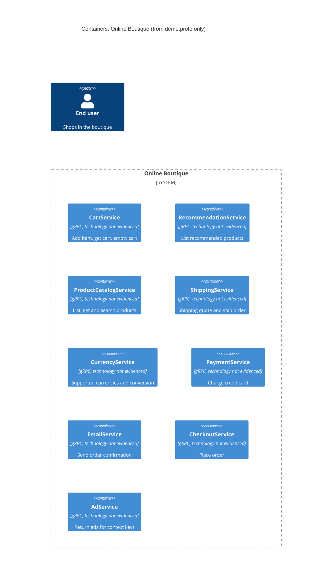

# Task 1 – Recovered architecture (run A)

## 1. Agent

Claude Code, model Sonnet 5.5 (`claude-sonnet-5-5`).

## 2. Files read

- `prompts/1-recover-architecture.md` (task file)
- `system/online-boutique/protos/demo.proto` (the only evidence)

## 3. Containers table

The proto defines one gRPC `service` per row below. Reading a `service` block as a separately deployed container is **[Inferred]**: the file defines interfaces, not deployment units.

| Container | Technology / language | Responsibility | Evidence |
|---|---|---|---|
| CartService | Not evidenced in the provided files (gRPC interface) | Add item, get cart, empty cart per `user_id` | `system/online-boutique/protos/demo.proto` (`service CartService`: `AddItem`, `GetCart`, `EmptyCart`) |
| RecommendationService | Not evidenced (gRPC interface) | List recommended product IDs for a user and given product IDs | `demo.proto` (`service RecommendationService`: `ListRecommendations`) |
| ProductCatalogService | Not evidenced (gRPC interface) | List, get and search products | `demo.proto` (`service ProductCatalogService`: `ListProducts`, `GetProduct`, `SearchProducts`) |
| ShippingService | Not evidenced (gRPC interface) | Quote shipping cost and ship an order | `demo.proto` (`service ShippingService`: `GetQuote`, `ShipOrder`) |
| CurrencyService | Not evidenced (gRPC interface) | List supported currencies and convert `Money` | `demo.proto` (`service CurrencyService`: `GetSupportedCurrencies`, `Convert`) |
| PaymentService | Not evidenced (gRPC interface) | Charge a credit card for an amount | `demo.proto` (`service PaymentService`: `Charge`) |
| EmailService | Not evidenced (gRPC interface) | Send order confirmation email | `demo.proto` (`service EmailService`: `SendOrderConfirmation`) |
| CheckoutService | Not evidenced (gRPC interface) | Place an order (`PlaceOrder`) | `demo.proto` (`service CheckoutService`: `PlaceOrder`) |
| AdService | Not evidenced (gRPC interface) | Return ads for given context keywords | `demo.proto` (`service AdService`: `GetAds`) |

Data stores: none evidenced.
Technology note: `option go_package` in `demo.proto` only names the Go package for generated code; it does not show the implementation language of any service.

## 4. Dependencies table

| Caller → Callee | Protocol | Evidence |
|---|---|---|
| None evidenced | – | `demo.proto` declares service interfaces only. It does not say who calls them. |

The proto shows that the services use gRPC and protobuf (`syntax = "proto3"`, `service` / `rpc`), but no caller → callee relationship.

## 5. Mermaid diagram

The end user is shown as required, but no `Rel` is drawn for them: no user-facing container is evidenced.

## 6. Gaps

| Gap | File that would settle it |
|---|---|
| Whether each `service` is a separately deployed container | `system/online-boutique/kubernetes-manifests/*.yaml` |
| Implementation language/framework of each service | `system/online-boutique/src/<service>/` (e.g. `Dockerfile`, build files) |
| Any caller → callee dependency. **[Inferred]** only from message types: `PlaceOrderRequest` / `OrderResult` / `ChargeRequest` / `GetQuoteRequest` reuse types from Cart, Payment, Shipping and Email, which suggests `CheckoutService` orchestrates them. This is not proof of calls. | `kubernetes-manifests/checkoutservice.yaml` (`*_SERVICE_ADDR` env vars) or `src/checkoutservice/` |
| Any user-facing container (web frontend) and the end user's protocol | `kubernetes-manifests/frontend.yaml` |
| Data stores (e.g. where `CartService` keeps carts, where `ProductCatalogService` gets products) | `kubernetes-manifests/cartservice.yaml`, `src/productcatalogservice/` |
| External systems (e.g. payment provider, email/SMTP) | Service source and manifests of `paymentservice` and `emailservice` |
| Message broker / async messaging | Manifests; `demo.proto` shows none |
