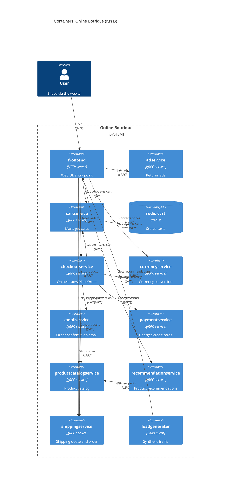

# Task 1 — Recovered architecture (run B)

## 1. Agent

Claude Code (Anthropic), model `claude-sonnet-5-5` (Sonnet 5.5).

## 2. Files read

Task and rules:
- `prompts/1-recover-architecture.md`

Evidence (`system/online-boutique/`):
- `protos/demo.proto`
- `kubernetes-manifests/adservice.yaml`
- `kubernetes-manifests/cartservice.yaml`
- `kubernetes-manifests/checkoutservice.yaml`
- `kubernetes-manifests/currencyservice.yaml`
- `kubernetes-manifests/emailservice.yaml`
- `kubernetes-manifests/frontend.yaml`
- `kubernetes-manifests/kustomization.yaml`
- `kubernetes-manifests/loadgenerator.yaml`
- `kubernetes-manifests/paymentservice.yaml`
- `kubernetes-manifests/productcatalogservice.yaml`
- `kubernetes-manifests/README.md`
- `kubernetes-manifests/recommendationservice.yaml`
- `kubernetes-manifests/shippingservice.yaml`

Also: I listed the `kubernetes-manifests/` directory with a shell `ls` to get the file names (a terminal command, contrary to `AGENTS.md`).

## 3. Containers table

Implementation languages are **not evidenced** in these files (manifests only reference images by name, e.g. `image: adservice`). "Technology" below gives only what the evidence shows.

| Name | Technology / language | Responsibility | Evidence |
|---|---|---|---|
| `frontend` | HTTP server (language not evidenced) | Serves the web UI; entry point for the user. Calls the backend services. | `kubernetes-manifests/frontend.yaml` (HTTP readiness probe `/_healthz`, `frontend-external` Service `type: LoadBalancer`, `*_SERVICE_ADDR` env vars) |
| `adservice` | gRPC service (language not evidenced) | Returns ads for page context keys. | `protos/demo.proto` (`service AdService`, `GetAds`); `kubernetes-manifests/adservice.yaml` (port 9555, `grpc` probe) |
| `cartservice` | gRPC service (language not evidenced) | Add/get/empty a user's cart. | `protos/demo.proto` (`service CartService`); `kubernetes-manifests/cartservice.yaml` (port 7070, `REDIS_ADDR`) |
| `redis-cart` | Redis (`image: redis:alpine`) | Data store for carts. Storage is an `emptyDir` volume at `/data`. | `kubernetes-manifests/cartservice.yaml` (Deployment/Service `redis-cart`, port 6379, `volumes: emptyDir`) |
| `checkoutservice` | gRPC service (language not evidenced) | Orchestrates order placement (`PlaceOrder`). | `protos/demo.proto` (`service CheckoutService`); `kubernetes-manifests/checkoutservice.yaml` (port 5050) |
| `currencyservice` | gRPC service (language not evidenced) | Lists supported currencies and converts `Money`. | `protos/demo.proto` (`service CurrencyService`); `kubernetes-manifests/currencyservice.yaml` (port 7000) |
| `emailservice` | gRPC service (language not evidenced) | Sends order confirmation. | `protos/demo.proto` (`service EmailService`, `SendOrderConfirmation`); `kubernetes-manifests/emailservice.yaml` (Service port 5000 → container 8080) |
| `paymentservice` | gRPC service (language not evidenced) | Charges a credit card (`Charge`). | `protos/demo.proto` (`service PaymentService`); `kubernetes-manifests/paymentservice.yaml` (port 50051) |
| `productcatalogservice` | gRPC service (language not evidenced) | Lists, gets and searches products. | `protos/demo.proto` (`service ProductCatalogService`); `kubernetes-manifests/productcatalogservice.yaml` (port 3550) |
| `recommendationservice` | gRPC service (language not evidenced) | Returns recommended product IDs. | `protos/demo.proto` (`service RecommendationService`); `kubernetes-manifests/recommendationservice.yaml` (port 8080) |
| `shippingservice` | gRPC service (language not evidenced) | Shipping quote and ship order. | `protos/demo.proto` (`service ShippingService`); `kubernetes-manifests/shippingservice.yaml` (port 50051) |
| `loadgenerator` | Load-testing client (tool not evidenced) | Generates synthetic user traffic against `frontend`. Not deployed by the default kustomization. | `kubernetes-manifests/loadgenerator.yaml` (`FRONTEND_ADDR`, `USERS`, `RATE`); `kubernetes-manifests/kustomization.yaml` (line `# - loadgenerator.yaml` commented out) |

## 4. Dependencies table

Protocol basis: for gRPC services, the dependency itself is **Evidenced** by an address env var; "gRPC" is **Evidenced** by the target's `service` definition in `demo.proto` plus its `grpc` probe/port name, but which RPCs a caller uses is not shown by the manifests.

| Caller → Callee | Protocol | Evidence (file and symbol) |
|---|---|---|
| User → `frontend` | HTTP | `kubernetes-manifests/frontend.yaml` (Service `frontend-external`, `type: LoadBalancer`, port 80 → 8080; `httpGet` probe) |
| `frontend` → `productcatalogservice` | gRPC | `frontend.yaml` (`PRODUCT_CATALOG_SERVICE_ADDR=productcatalogservice:3550`) |
| `frontend` → `currencyservice` | gRPC | `frontend.yaml` (`CURRENCY_SERVICE_ADDR=currencyservice:7000`) |
| `frontend` → `cartservice` | gRPC | `frontend.yaml` (`CART_SERVICE_ADDR=cartservice:7070`) |
| `frontend` → `recommendationservice` | gRPC | `frontend.yaml` (`RECOMMENDATION_SERVICE_ADDR=recommendationservice:8080`) |
| `frontend` → `shippingservice` | gRPC | `frontend.yaml` (`SHIPPING_SERVICE_ADDR=shippingservice:50051`) |
| `frontend` → `checkoutservice` | gRPC | `frontend.yaml` (`CHECKOUT_SERVICE_ADDR=checkoutservice:5050`) |
| `frontend` → `adservice` | gRPC | `frontend.yaml` (`AD_SERVICE_ADDR=adservice:9555`) |
| `checkoutservice` → `productcatalogservice` | gRPC | `checkoutservice.yaml` (`PRODUCT_CATALOG_SERVICE_ADDR=productcatalogservice:3550`) |
| `checkoutservice` → `shippingservice` | gRPC | `checkoutservice.yaml` (`SHIPPING_SERVICE_ADDR=shippingservice:50051`) |
| `checkoutservice` → `paymentservice` | gRPC | `checkoutservice.yaml` (`PAYMENT_SERVICE_ADDR=paymentservice:50051`) |
| `checkoutservice` → `emailservice` | gRPC | `checkoutservice.yaml` (`EMAIL_SERVICE_ADDR=emailservice:5000`) |
| `checkoutservice` → `currencyservice` | gRPC | `checkoutservice.yaml` (`CURRENCY_SERVICE_ADDR=currencyservice:7000`) |
| `checkoutservice` → `cartservice` | gRPC | `checkoutservice.yaml` (`CART_SERVICE_ADDR=cartservice:7070`) |
| `recommendationservice` → `productcatalogservice` | gRPC | `recommendationservice.yaml` (`PRODUCT_CATALOG_SERVICE_ADDR=productcatalogservice:3550`) |
| `cartservice` → `redis-cart` | Redis protocol over TCP **[Inferred]** from port name `tcp-redis` / `redis` image; TCP is evidenced | `cartservice.yaml` (`REDIS_ADDR=redis-cart:6379`; Service `redis-cart` port 6379, name `tcp-redis`) |
| `loadgenerator` → `frontend` | HTTP | `loadgenerator.yaml` (`FRONTEND_ADDR=frontend:80`; init container `wget http://${FRONTEND_ADDR}`) |

No dependency is shown for `adservice`, `currencyservice`, `emailservice`, `paymentservice`, `productcatalogservice` or `shippingservice` as callers.

## 5. Mermaid diagram

## 6. Gaps

| Gap | Why unknown | Extra file that would settle it |
|---|---|---|
| `frontend` → `shoppingassistantservice:80` | `frontend.yaml` sets `SHOPPING_ASSISTANT_SERVICE_ADDR`, but no manifest defines that service; the `shopping-assistant` kustomize component is commented out in `kustomization.yaml`, and `ENABLE_ASSISTANT` is commented out. Not in diagram. Protocol (port 80) also unknown. | `system/online-boutique/kustomize/components/shopping-assistant/` and `src/frontend/` |
| Implementation language of each service | Manifests only name images; `demo.proto` sets only a Go package option. | `src/<service>/` (e.g. `Dockerfile`, source) or `skaffold.yaml` |
| Product data source of `productcatalogservice` | No env var or volume for a database in its manifest. | `src/productcatalogservice/` |
| Whether `emailservice` calls an external mail provider | No env var or address shown; no `System_Ext` added. | `src/emailservice/` |
| Whether `paymentservice` calls an external payment provider | Same. | `src/paymentservice/` |
| Whether `adservice`, `currencyservice`, `paymentservice`, `shippingservice`, `emailservice` call other services | Manifests list no `*_ADDR` env vars for them; code could still use other config. | Source under `src/` |
| Which RPCs each caller uses | Env vars show target, not method. | Caller source (e.g. `src/frontend/`, `src/checkoutservice/`) |
| Redis wire protocol (RESP) | Only port name `tcp-redis`, image `redis:alpine` and `REDIS_ADDR` shown. | `src/cartservice/` |
| Whether `loadgenerator` is part of the deployed system | File exists but is commented out of `kustomization.yaml` ("During development, the loadgenerator module inside skaffold.yaml will be used"). Included in the diagram because its manifest shows a runtime dependency. | `skaffold.yaml` |
| Ingress / external exposure details | Only a `LoadBalancer` Service is shown, no Ingress or gateway. | Cloud/cluster configuration, `kustomize/` |
| Persistence of `redis-cart` | `emptyDir` suggests non-persistent storage in this manifest; other deployments (e.g. `memorystore`, `alloydb`, `spanner` components) are commented out and not inspected. | `kustomize/components/*` |
| Manifests are not directly deployable | `kubernetes-manifests/README.md` says they are for `skaffold` and points to `/release` for deployable ones. | `release/` manifests |
